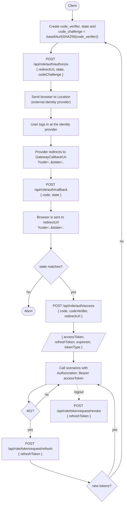

# Backlot.Authentication.Bearer

Bearer authentication where Backlot is always the token issuer. Backlot acts as a **gateway** to an
external OpenID Connect identity provider (Auth0, Entra ID, Keycloak, ...), which handles the login.

## Setup

Register the user context and a token store in your director:

```csharp
public class WebDirector(...) : AutofacContainerDirector<..., BearerUserContext, ...>(...)
{
    public override void Registration()
    {
        base.Registration();

        Builder.RegisterType<JwtTokenStore>().As<ITokenStore>().SingleInstance();
    }
}
```

Settings (`Backlot.Authentication.Bearer.Settings.*`):

| Setting | |
|---------|-|
| `SigningKey` | Required, at least 32 characters. Signs tokens, codes and state. |
| `AllowedRedirectUris` | Comma separated, exact match. |
| `Issuer`, `Audience` | Defaults to `backlot`. |
| `AccessTokenLifetimeMinutes`, `RefreshTokenLifetimeDays` | Defaults to 15 minutes and 14 days. |
| `GatewayAuthority` | Required, e.g. `https://tenant.eu.auth0.com/`. |
| `GatewayClientId`, `GatewayClientSecret` | Client at the identity provider. The secret stays on the server. |
| `GatewayCallbackUri` | Absolute url of the LoginPage, e.g. `https://api.example.com/api/role/director/loginpage`. Register it at the provider. |
| `GatewayAudience`, `GatewayScopes` | Optional, defaults to scopes `openid profile email`. |
| `GatewayUserNameClaim`, `GatewayGroupsClaim` | Defaults to `email` and `groups`. |

## Client flow (authorization code with PKCE)

1. Create a `code_verifier` and `code_challenge = base64url(SHA256(code_verifier))`.
2. Send the browser to
   `GET /api/role/director/loginpage?redirect_uri=..&state=..&code_challenge=..&code_challenge_method=S256`.
3. The browser comes back at `redirect_uri?code=..&state=..`. Check `state`.
4. `POST /api/role/auth/access` with
   `{ "code": "..", "codeVerifier": "..", "redirectUrl": ".." }`
   returns `{ accessToken, refreshToken, expiresIn, tokenType }`.
5. Call scenarios with `Authorization: Bearer <accessToken>`.
6. Refresh with `POST /api/role/refreshrequest/refresh` and `{ "refreshToken": ".." }`.
7. Logout with `POST /api/role/revokerequest/revoke` and `{ "refreshToken": ".." }`.

Authorization codes are signed, live 2 minutes and are bound to the redirect uri and the code challenge.

### Request flow



## Extending

The package works as-is. To customize it:

- **Own token management**: implement `ITokenStore` (for example database or Redis backed, with
  real revocation) and register it instead of `JwtTokenStore`. No scenarios need to be written.
- **User mapping (gateway)**: `PrepareCompositionFor<Callback>(s => s.MapUser = ...)`.
- **Claims**: inherit `BearerUserContext` and override `MapUser`.
